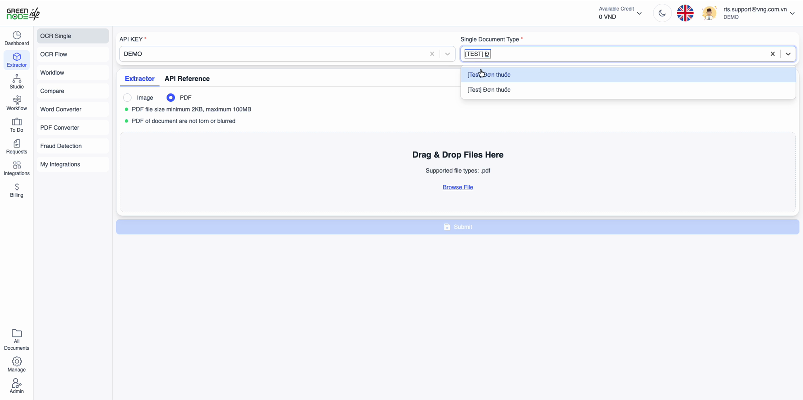

# Tự định nghĩa biểu mẫu mới

Ngoài danh mục biểu mẫu dựng sẵn, GreenNode IDP cho phép người dùng tự khai báo một loại tài liệu mới theo nghiệp vụ riêng của tổ chức. Toàn bộ quá trình thực hiện trực tiếp trên portal: người dùng tải tài liệu mẫu lên, khoanh vùng những trường thông tin cần lấy, hệ thống tự sinh mô tả cho từng trường và kiểm chứng lại trên một tài liệu thứ hai trước khi đưa vào sử dụng.

Người dùng không cần kiến thức lập trình và không phải chờ GreenNode huấn luyện mô hình mới. Thời gian hoàn tất một biểu mẫu thông thường chỉ vài phút.

#### 1. Bốn giai đoạn của một biểu mẫu

Mỗi biểu mẫu đi qua bốn giai đoạn, hiển thị trên thanh trạng thái ở đầu màn hình:

<table data-header-hidden><thead><tr><th valign="top"></th><th valign="top"></th><th valign="top"></th></tr></thead><tbody><tr><td valign="top">Giai đoạn</td><td valign="top">Ý nghĩa</td><td valign="top">Việc người dùng làm</td></tr><tr><td valign="top">NEW</td><td valign="top">Vừa khai báo thông tin chung</td><td valign="top">Đặt tên, mã, tiêu đề nhận dạng</td></tr><tr><td valign="top">TEMPLATE</td><td valign="top">Định nghĩa các trường trên tài liệu mẫu</td><td valign="top">Tải mẫu, khai báo trường, khoanh vùng dữ liệu</td></tr><tr><td valign="top">REVIEW</td><td valign="top">Kiểm chứng trên tài liệu thứ hai</td><td valign="top">Tải tài liệu khác cùng loại, xác nhận kết quả</td></tr><tr><td valign="top">ACTIVE</td><td valign="top">Biểu mẫu đã sẵn sàng</td><td valign="top">Dùng trong workflow hoặc gọi qua Extractor</td></tr></tbody></table>

#### 2. Chuẩn bị trước khi bắt đầu

·       Ít nhất hai tài liệu mẫu cùng loại: một dùng để định nghĩa trường, một dùng để kiểm chứng ở giai đoạn Review.

·       Tài liệu ở định dạng ảnh hoặc PDF, chữ rõ, không bị mờ hoặc tối.

·       Danh sách các trường thông tin cần lấy ra, xác định trước loại dữ liệu của từng trường.

#### 3. Các bước thực hiện

**Bước 1 — Mở danh mục biểu mẫu và tạo mới**

* Trên thanh điều hướng bên trái, chọn mục AI Models Hub.
* Chọn Document Template để mở danh sách biểu mẫu hiện có của tổ chức.
* Nhấn nút Create ở góc trên bên phải.

<figure><figcaption>
<em>Danh sách Document Template và hộp thoại Create</em>
</figcaption></figure>

**Bước 2 — Khai báo thông tin biểu mẫu**

Điền các thông tin sau trong hộp thoại Create:

<table data-header-hidden><thead><tr><th valign="top"></th><th valign="top"></th><th valign="top"></th></tr></thead><tbody><tr><td valign="top"><strong>Trường</strong></td><td valign="top"><strong>Bắt buộc</strong></td><td valign="top"><strong>Mô tả</strong></td></tr><tr><td valign="top">Name</td><td valign="top">Có</td><td valign="top">Tên biểu mẫu hiển thị trong danh mục. Nên đặt theo nghiệp vụ để dễ tra cứu.</td></tr><tr><td valign="top">Code</td><td valign="top">Có</td><td valign="top">Mã biểu mẫu dùng khi gọi API và khi đối soát cước. Viết hoa, không dấu, không khoảng trắng.</td></tr><tr><td valign="top">Description</td><td valign="top">Không</td><td valign="top">Mô tả ngắn về phạm vi sử dụng của biểu mẫu.</td></tr><tr><td valign="top">Titles</td><td valign="top">Có</td><td valign="top">Các tiêu đề xuất hiện trên tài liệu, dùng để hệ thống phân loại tài liệu trong workflow. Nhập từng tiêu đề rồi nhấn Enter để thêm.</td></tr><tr><td valign="top">Subtitles</td><td valign="top">Không</td><td valign="top">Tiêu đề phụ, khai báo tương tự Titles.</td></tr></tbody></table>

Nhấn Submit để tạo. Hệ thống chuyển sang màn hình định nghĩa trường và biểu mẫu ở giai đoạn TEMPLATE.

<figure><figcaption>
<em>Hộp thoại Create sau khi điền đủ thông tin</em>
</figcaption></figure>

**Bước 3 — Tải tài liệu mẫu lên**

Màn hình chia làm hai phần: bên trái là khu vực tài liệu, bên phải là bảng Fields Definition. Lúc này cả hai đều đang trống.

<figure><figcaption>
<em>Màn hình định nghĩa biểu mẫu khi chưa có tài liệu</em>
</figcaption></figure>

Tại khung Drag & drop or click to upload ở góc dưới bên trái, kéo thả tệp vào hoặc nhấn để chọn tệp.

Chờ thông báo Upload file successful.

Tài liệu hiển thị ở khung xem chính giữa. Dùng nút phóng to, thu nhỏ hoặc hộp tỷ lệ phần trăm để xem rõ hơn.

<figure><figcaption>
<em>Tài liệu mẫu sau khi tải lên thành công</em>
</figcaption></figure>

**Bước 4 — Khai báo các trường cần trích xuất**

Ở bảng Fields Definition bên phải, nhập tên trường vào ô Label, chọn kiểu dữ liệu ở danh sách bên cạnh, rồi nhấn nút dấu cộng để thêm. Lặp lại cho từng trường cần lấy.

Hệ thống hỗ trợ tám kiểu dữ liệu:

<table data-header-hidden><thead><tr><th valign="top"></th><th valign="top"></th></tr></thead><tbody><tr><td valign="top">Kiểu</td><td valign="top"><strong>Dùng cho</strong></td></tr><tr><td valign="top">Text</td><td valign="top">Chuỗi ký tự thông thường: họ tên, địa chỉ, chẩn đoán.</td></tr><tr><td valign="top">Number</td><td valign="top">Giá trị số: tuổi, số lượng, thành tiền.</td></tr><tr><td valign="top">Boolean</td><td valign="top">Giá trị đúng hoặc sai, ô đánh dấu.</td></tr><tr><td valign="top">Date</td><td valign="top">Ngày tháng, hệ thống chuẩn hoá về định dạng thống nhất.</td></tr><tr><td valign="top">Group</td><td valign="top">Nhóm nhiều trường con đi liền nhau và lặp lại nhiều lần trên tài liệu.</td></tr><tr><td valign="top">List</td><td valign="top">Danh sách nhiều dòng có cùng cấu trúc.</td></tr><tr><td valign="top">Table</td><td valign="top">Bảng có hàng và cột cố định.</td></tr><tr><td valign="top">Stamp</td><td valign="top">Vùng con dấu.</td></tr></tbody></table>

<figure><figcaption></figcaption></figure>

**Bước 5 — Khoanh vùng dữ liệu trên tài liệu**

* Nhấn nút Draw ở dòng trường cần khai báo. Nút chuyển thành Stop.
* Kéo chuột để khoanh vùng chứa dữ liệu của trường đó trên tài liệu.
* &#x20;Hệ thống đọc nội dung trong vùng vừa khoanh và điền vào ô Value của trường. Vùng khoanh được đánh số Box #1.
* Kiểm tra giá trị hệ thống đọc được. Nếu chưa đúng, người dùng sửa trực tiếp trong ô Value.
* Nhấn Stop để kết thúc và chuyển sang trường tiếp theo.

<figure><figcaption>
<em>Khoanh vùng tiêu đề tài liệu, giá trị được điền tự động vào ô Value</em>
</figcaption></figure>

**Bước 6 — Khai báo trường dạng danh sách hoặc nhóm**

Với dữ liệu lặp lại nhiều dòng — chẳng hạn danh sách thuốc trong đơn thuốc hay danh sách hàng hoá trên hoá đơn — người dùng chọn kiểu List hoặc Group thay vì Text. Trường loại này có thêm hai phần:

<table data-header-hidden><thead><tr><th valign="top"></th><th valign="top"></th></tr></thead><tbody><tr><td valign="top"><strong>Phần</strong></td><td valign="top"><strong>Nội dung</strong></td></tr><tr><td valign="top">TEMPLATE FIELDS</td><td valign="top">Khai báo cấu trúc chung của một dòng: tên các trường con. Ví dụ một dòng thuốc gồm Tên thuốc, Số lượng, Đơn vị.</td></tr><tr><td valign="top">GROUP INSTANCES</td><td valign="top">Từng dòng dữ liệu thực tế trên tài liệu mẫu. Nhấn Add Group Instance để thêm một dòng, sau đó khoanh vùng cho từng trường con của dòng đó.</td></tr></tbody></table>

<figure><figcaption>
<em>Khai báo trường con trong phần TEMPLATE FIELDS</em>
</figcaption></figure>

Sau khi khai báo xong cấu trúc, nhấn Add Group Instance rồi dùng nút Draw để khoanh vùng từng trường con trên dòng tương ứng, giống như ở Bước 5.

<figure><figcaption>
<em>Khoanh vùng dữ liệu cho từng trường con trong một dòng</em>
</figcaption></figure>

**Bước 7 — Lưu và sinh mô tả tự động**

1\.       Nhấn Save để lưu toàn bộ cấu hình. Hệ thống báo Document template updated successfully.

2\.       Nhấn Generate Description. Hệ thống phân tích các vùng đã khoanh và tự viết mô tả cho từng trường — mô tả này giúp mô hình nhận biết đúng trường trên những tài liệu khác có bố cục khác đi.

3\.       Trạng thái tài liệu mẫu chuyển lần lượt qua GET\_DESCRIPTION rồi READY\_CONFIRM.

<figure><figcaption>
<em>Hệ thống tiếp nhận yêu cầu sinh mô tả</em>
</figcaption></figure>

Khi trạng thái chuyển sang READY\_CONFIRM, mỗi trường đã có phần mô tả do hệ thống sinh ra và nút Done chuyển sang trạng thái sử dụng được. Người dùng đọc lại các mô tả, chỉnh sửa nếu cần, rồi nhấn Done để chuyển sang giai đoạn Review.

<figure><figcaption>
<em>Mô tả tự động của từng trường và nút Done đã sẵn sàng</em>
</figcaption></figure>

**Bước 8 — Kiểm chứng ở giai đoạn Review**

Giai đoạn Review dùng một tài liệu khác cùng loại để kiểm tra xem biểu mẫu có hoạt động đúng trên bố cục khác hay không. Đây là bước quyết định chất lượng của biểu mẫu, không nên bỏ qua.

<figure><figcaption>
<em>Giai đoạn Review, chưa có tài liệu kiểm chứng</em>
</figcaption></figure>

Tải lên một tài liệu khác cùng loại nhưng khác bố cục hoặc khác đơn vị phát hành. Chờ hệ thống xử lý qua trạng thái GET\_TEXT. Đối chiếu giá trị hệ thống đọc được với nội dung trên tài liệu. Với trường sai hoặc còn trống, nhấn Draw để khoanh lại vùng đúng.

Với trường dạng nhóm, thêm đủ số dòng bằng nút Add Group Instance rồi khoanh vùng cho từng dòng.

Nhấn Save, sau đó nhấn Generate Description để hệ thống cập nhật lại mô tả theo dữ liệu vừa bổ sung.

<figure><figcaption>
<em>Kiểm chứng trên tài liệu thứ hai có bố cục dạng bảng</em>
</figcaption></figure>

Khi trạng thái chuyển sang READY\_CONFIRM, nhấn Done. Hệ thống báo Document template review confirmed successfully và tài liệu kiểm chứng chuyển sang trạng thái COMPLETED.

**Bước 9 — Biểu mẫu chuyển sang trạng thái ACTIVE**

Sau khi xác nhận, thanh trạng thái ở đầu màn hình hiển thị đủ bốn giai đoạn đã hoàn thành. Biểu mẫu sẵn sàng sử dụng, không cần thao tác thêm.

<figure><figcaption>
<em>Biểu mẫu đã đạt trạng thái ACTIVE</em>
</figcaption></figure>

**Bước 10 — Sử dụng biểu mẫu vừa tạo**

Biểu mẫu mới xuất hiện ngay trong danh mục loại tài liệu và dùng được theo hai cách: gán vào workflow ở tab Models, hoặc gọi trực tiếp qua Extractor để xử lý từng tệp.

* Vào mục Extractor, chọn OCR Single.
* Ở ô Single Document Type, chọn biểu mẫu vừa tạo. Có thể gõ một phần tên để lọc nhanh.
* Kéo thả tệp cần xử lý vào khung Drag & Drop Files Here rồi nhấn Submit.

<figure><figcaption>
<em>Chọn biểu mẫu vừa tạo trong Extractor</em>
</figcaption></figure>

Hệ thống trả về màn hình Extraction Result với dữ liệu đã bóc tách, kèm độ tin cậy của từng trường. Người dùng đối chiếu với ảnh gốc hiển thị bên trái, bật hoặc tắt công tắc xác nhận ở mỗi dòng, và gửi phản hồi qua nút Feedback nếu phát hiện sai sót.

<figure><figcaption>
<em>Kết quả trích xuất kèm độ tin cậy của từng trường</em>
</figcaption></figure>
