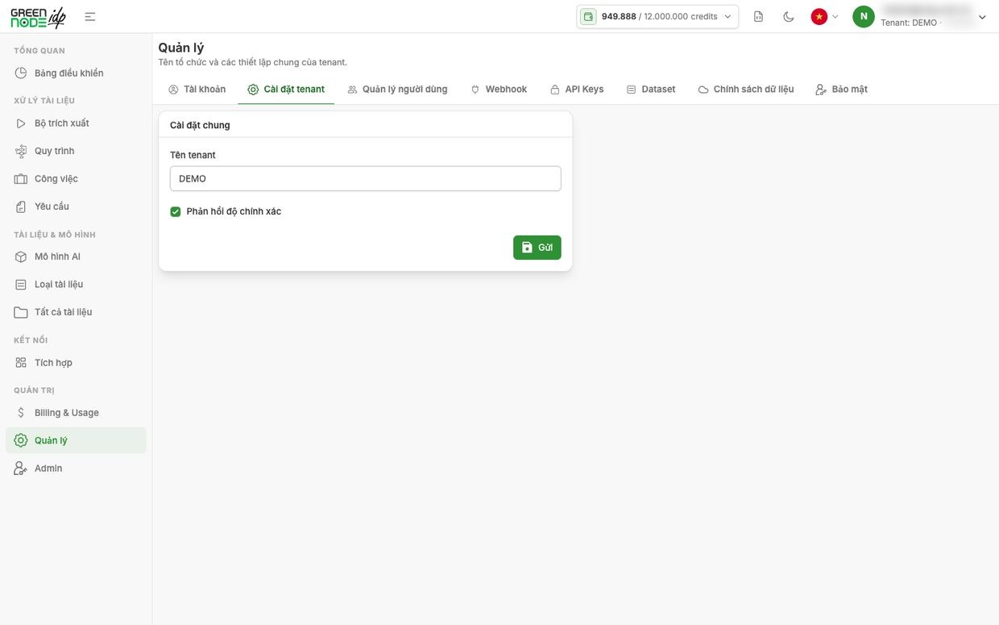

# Cài đặt tenant

•     Tên tenant: đổi tên rồi bấm Gửi.

•     Phản hồi độ chính xác: bật để người dùng đánh giá _Chính xác / Sai_ cho kết quả. Dữ liệu này dùng để đo độ chính xác (Export Accuracy).

<figure><figcaption></figcaption></figure>
